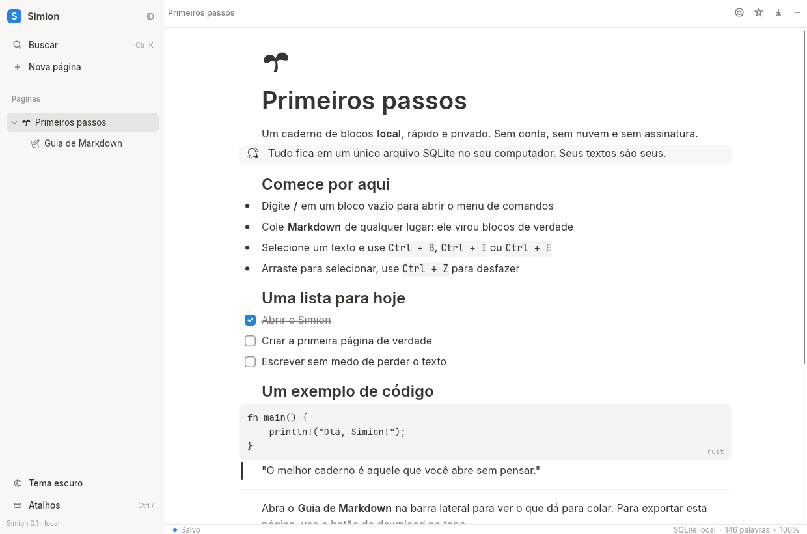
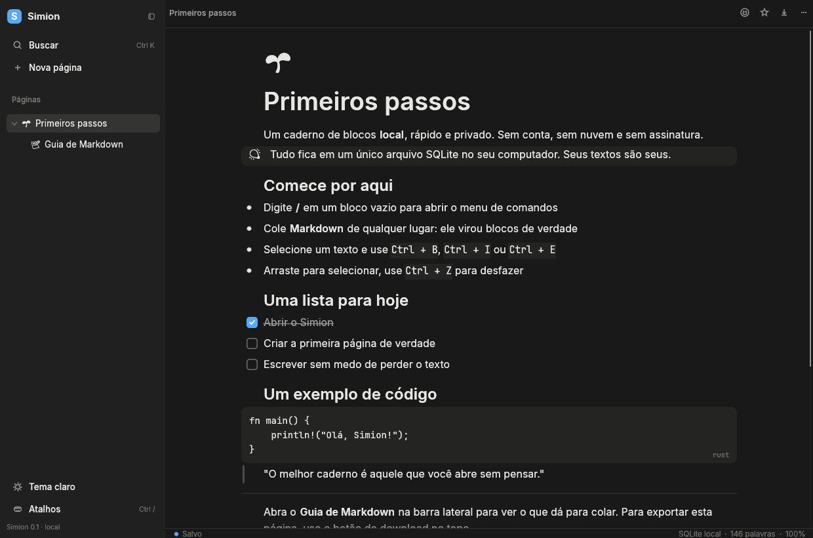

# Simion

**Um caderno de blocos local, leve e bonito — um clone do Notion feito em Rust.**

Simion é um aplicativo desktop de anotações com a sensação de edição do Notion, mas
sem Electron, sem webview, sem conta e sem nuvem. Tudo vive em um único arquivo SQLite
no seu computador. O nome é uma brincadeira com *Notion*: **não** vira **sim**.



## O que já funciona

- **Editor de blocos** no estilo Notion: parágrafo, título 1/2/3, lista com marcadores,
  lista numerada, lista de tarefas, citação, destaque (callout), bloco de código e divisor.
- **Formatação inline em Markdown de verdade**: negrito, itálico, riscado, código e links.
  Os marcadores ficam escondidos enquanto você lê e aparecem suavemente quando o cursor
  está dentro do trecho — dá para editar o Markdown sem perder a leitura limpa.
- **Atalhos de Markdown ao digitar**: `# `, `## `, `### `, `- `, `1. `, `[] `, `> `,
  ` ``` ` e `---` transformam o bloco na hora.
- **Colar Markdown** de qualquer lugar: um documento inteiro vira títulos, listas,
  tarefas, citações, código e divisores. Também dá para importar arquivos `.md`
  arrastando para a janela.
- **Menu `/`** com busca por comandos (aceita `h1`, `todo`, `tabela`…), navegação por
  teclado e prévia da sintaxe.
- **Menu de bloco**: transformar, duplicar, copiar, mover e excluir, pelo botão `⋮⋮`
  que aparece na margem esquerda. O botão `+` insere um bloco logo abaixo.
- **Páginas hierárquicas** na barra lateral, com favoritos, ícone/emoji, renomear,
  duplicar, excluir (com confirmação), exportar e copiar Markdown.
- **Busca local** (`Ctrl+K`) em títulos e conteúdo, com trechos destacados e
  **insensível a acentos** (`citacao` encontra `citação`).
- **Desfazer/refazer** com agrupamento de digitação (um `Ctrl+Z` desfaz uma rajada,
  não uma letra por vez).
- **Salvamento automático** (600 ms de inatividade), ao trocar de página, ao fechar e
  ao mudar o ícone. Nada de botão “salvar”.
- **Tema claro/escuro**, zoom, barra lateral redimensionável e status bar com contagem
  de palavras, estado de salvamento e caminho do banco.
- **Importação/exportação**: exporta `.md` para `~/Documentos/Simion/`, copia o
  Markdown da página e importa `.md` por arrastar-e-soltar.
- **Tudo offline**: um único binário, um único arquivo de dados.



## Atalhos

| Atalho | Ação |
| --- | --- |
| `Ctrl+K` | Buscar em todas as páginas |
| `Ctrl+N` | Nova subpágina da página atual |
| `Ctrl+S` | Salvar agora |
| `Ctrl+\` | Mostrar/ocultar barra lateral |
| `Ctrl+/` | Lista de atalhos |
| `Ctrl+Z` / `Ctrl+Shift+Z` / `Ctrl+Y` | Desfazer / refazer |
| `Ctrl+B` / `Ctrl+I` / `Ctrl+E` | Negrito / itálico / código inline |
| `Ctrl+Shift+S` | Riscado |
| `Ctrl+Shift+K` | Inserir link (`[texto](url)`) |
| `Ctrl+Alt+1/2/3` | Transformar em título 1/2/3 |
| `Ctrl+Alt+0` | Voltar a texto |
| `Tab` / `Shift+Tab` | Aumentar / diminuir recuo |
| `Alt+↑` / `Alt+↓` | Mover bloco |
| `Enter` | Dividir o bloco |
| `Shift+Enter` | Quebra de linha dentro do bloco |
| `Backspace` no início | Juntar com o bloco anterior / dedent |
| `Delete` no fim | Juntar o próximo bloco |
| `↑` / `↓` nas bordas | Navegar entre blocos |
| `/` no início de um bloco | Menu de comandos |
| `Ctrl+Shift+M` | Ver o Markdown da página |
| `Ctrl+=` / `Ctrl+-` / `Ctrl+0` | Zoom |

## Rodando

Pré-requisitos: **Rust estável** (edition 2024), um compilador C (o SQLite é compilado
junto) e os drivers gráficos da plataforma (OpenGL + X11 ou Wayland).

```bash
cargo run --release
```

Para gerar o binário final:

```bash
cargo build --release
# o executável fica em target/release/simion
```

Em Debian/Ubuntu, as dependências de sistema típicas são:

```bash
sudo apt install build-essential pkg-config \
  libxkbcommon-dev libwayland-dev libx11-dev libxi-dev libgl1-mesa-dev
```

O app também roda em macOS e Windows (eframe/winit/glow); a interface foi desenhada
para teclado e mouse, sem exigir nada específico de plataforma.

### Onde ficam as anotações

| Sistema | Caminho |
| --- | --- |
| Linux | `~/.local/share/simion/simion.db` (ou `$XDG_DATA_HOME/simion/simion.db`) |
| macOS | `~/Library/Application Support/Simion/simion.db` |
| Windows | `%APPDATA%\Simion\simion.db` |

Para usar uma pasta diferente (testes, pendrive, backup):

```bash
SIMION_DATA_DIR=/caminho/para/dados cargo run --release
```

O SQLite é aberto em modo **WAL**. Backups seguros podem ser feitos com a página
aberta: copie `simion.db`, `simion.db-wal` e `simion.db-shm`, ou use o botão de
exportar Markdown. O app cria duas páginas de boas-vindas no primeiro uso.

## Como foi feito

O Simion não usa HTML nem motor de browser. A interface é desenhada com **egui/eframe**
(immediate mode) e o texto é composto por um *layouter* próprio, que entende Markdown
inline e desenha cada trecho com a fonte e o estilo corretos. O resultado é um binário
pequeno, sem runtime JavaScript e com resposta imediata.

```
src/
  main.rs       Entrada do app (eframe/glow)
  app.rs        Estado, ações, atalhos, salvamento e frame principal
  editor.rs     Editor de blocos, layouter inline, gutter (+/⋮⋮), virtualização
  markdown.rs   Parser inline, Markdown ⇄ blocos, serialização e atalhos
  store.rs      SQLite (schema, CRUD, busca, seed, export)
  sidebar.rs    Árvore de páginas, favoritos, rodapé
  search.rs     Overlay de busca
  overlays.rs   Menus, emoji, modais, toasts e drag-and-drop
  ui.rs         Botões, linhas de menu, dicas de teclado
  icons.rs      Ícones vetoriais desenhados à mão
  icon.rs       Ícone da janela gerado em runtime
  theme.rs      Paleta, tipografia e estilo do egui
  model.rs      Páginas, blocos e tipos
```

Decisões que valem a pena conhecer:

- **Markdown é a fonte da verdade.** Cada bloco guarda o texto com seus marcadores
  (`**forte**`, `` `código` ``). O layouter esconde os marcadores, mas mantém os
  índices de caractere, então seleção, cursor e atalhos continuam exatos.
- **SQLite local** com `fold()` registrado em Rust para busca sem acentos. Sem FTS,
  sem serviço, sem dependência extra.
- **Virtualização** de páginas longas: só os blocos visíveis (mais uma margem) são
  construídos, usando alturas medidas e estimativas. A matemática do scroll é feita
  em coordenadas de conteúdo — detalhe que evita a página “sumir” ao chegar ao fim.
- **Histórico agrupado** por tempo (checkpoints a cada ~0,9 s de digitação), com
  snapshots forçados em operações estruturais.
- **Sem nuvem**: o processo não abre conexões de rede.
- **Binário enxuto**: cerca de 13 MB no release, sem Electron, sem webview e sem
  runtime JavaScript.

### Testes

```bash
cargo test
```

A suíte cobre o parser inline (inclusive marcadores aninhados e links), ida-e-volta
Markdown ⇄ blocos, atalhos, conversão char/byte, CRUD do SQLite, exclusão em cascata
e busca sem acentos.

O binário de release também foi aberto com o **MCP do REA** (ferramenta de engenharia
reversa), que o identificou como `format=elf`, `kind=executable`, `architecture=x86_64`
e registrou o SHA-256 do artefato. O provedor Ghidra ficou disponível na sessão para
análise mais profunda; a checagem de runtime usada aqui foi a de que o processo não
abre conexões de rede.

## Limitações conhecidas

O objetivo é ser um caderno local excelente, não uma cópia 1:1 do Notion. Ainda não há:

- imagens, tabelas, blocos toggle, embeds ou bancos de dados;
- colaboração, comentários, histórico de versões ou sincronização;
- seleção de vários blocos ao mesmo tempo;
- reordenação de páginas arrastando na barra lateral;
- duplicar uma página copia só o conteúdo dela, não as subpáginas;
- ícones de página monocromáticos (usa a fonte de emoji embutida no egui);
- página “lixo” separada: excluir é definitivo (com confirmação).

Essas escolhas mantêm o app pequeno e o código auditável.

## Licença

Código sob [MIT](LICENSE). As fontes incluídas em `assets/fonts/` têm suas próprias
licenças:

- Inter — SIL Open Font License (`OFL-Inter.txt`)
- JetBrains Mono — Apache 2.0 (`LICENSE-JetBrainsMono.txt`, `LICENSE-Apache-2.0.txt`)
- Noto Emoji — SIL Open Font License (`OFL-NotoEmoji.txt`)
- emoji-icon-font — MIT (`MIT-emoji-icon-font.txt`)

Feito com [egui/eframe](https://github.com/emilk/egui), [rusqlite](https://github.com/rusqlite/rusqlite)
e SQLite.
